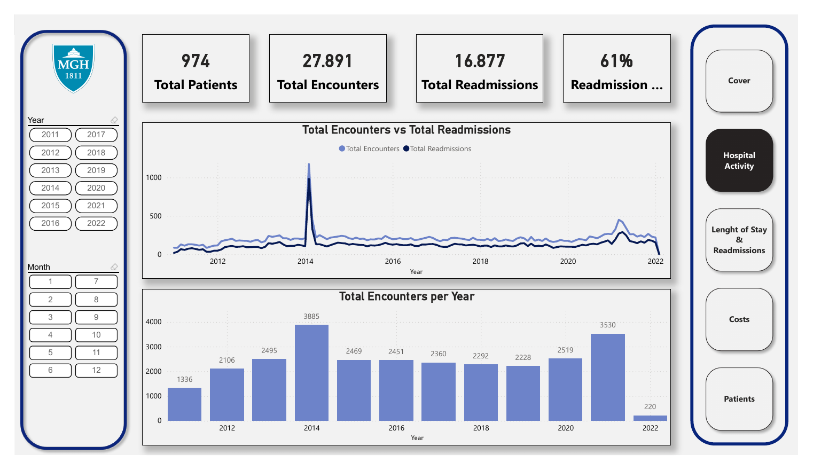
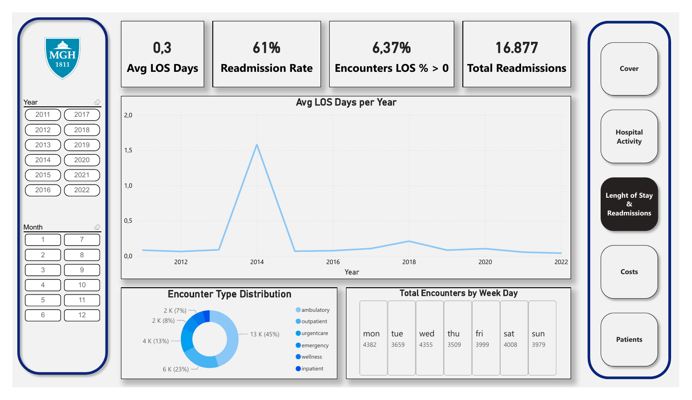
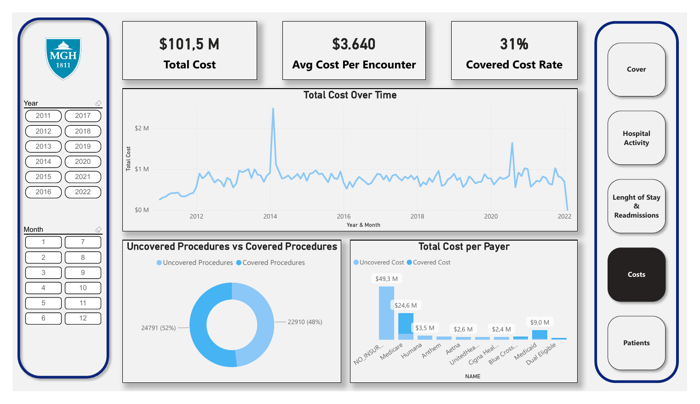
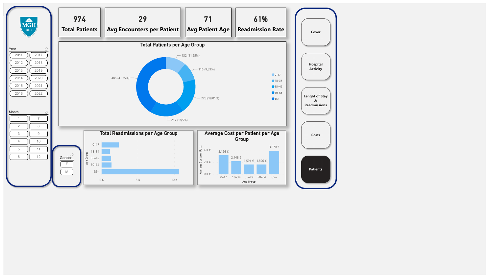

# Hospital KPI Dashboard (Power BI)

An executive KPI report for Massachusetts General Hospital built in Power BI, giving leadership visibility into recent hospital activity, length of stay, readmissions, costs and insurance coverage. The report is designed to take in new data over time.

Individual project for the *Business Analytics Fundamentals* course, MSc in Data Science, ISCTE (2025/26).

## Business questions

- How many patients were admitted or readmitted over time, and when are the busiest periods?
- How long do patients stay on average, and what is the readmission rate?
- What is the average cost per visit?
- How many procedures are covered by insurance?

## Report pages

| Page | Contents |
|---|---|
| Hospital Activity | Total encounters, patients and readmissions, readmission rate, monthly trend and encounters per year |
| Length of Stay & Readmissions | Average length of stay (days) by year, encounters by class, activity by weekday, readmission KPIs |
| Costs | Total cost and average cost per encounter, monthly cost trend, covered vs uncovered cost by payer, procedure coverage |
| Patients | Patients by age group and gender, average cost per patient, readmissions by age group, average encounters per patient |

Every page has year, month and (on the Patients page) gender slicers, plus page navigation buttons.

## Screenshots

A PDF export of the full report is in [`hospital_kpi_report.pdf`](hospital_kpi_report.pdf).

## How it was built

- **ETL in Power Query:** loaded and cleaned the encounter files (2011 to 2022) and the patient, payer, organisation and procedure tables.
- **Data model:** star schema with two fact tables (`FCT_Encounters`, `FCT_Procedures`) and dimension tables for date, patients, payers, organisations, encounter codes, procedure codes and reasons.
- **DAX measures** (kept in a dedicated measures table): total encounters, patients and readmissions, readmission rate, average length of stay, total, covered and uncovered cost, covered cost rate, average cost per encounter and per patient, covered vs uncovered procedures, average patient age.
- **Visuals:** KPI cards, line, column, combo and donut charts, Chiclet Slicer (AppSource) and page navigators.

## Data

Synthetic patient records generated with [Synthea](https://synthetichealth.github.io/synthea/), so no real patient data is involved. The source tables are encounters, patients, payers, procedures and organizations. The raw CSV files the report was built from are in `data/raw/`. See `data/data_dictionary.csv` for field descriptions and `data/citation.txt` for the reference. The data is also embedded in the `.pbix` file, so the report opens without them.

## How to open

To view it without Power BI, open `hospital_kpi_report.pdf`. To explore it interactively, download `hospital_kpi_report.pbix` and open it in [Power BI Desktop](https://powerbi.microsoft.com/desktop/) (free, Windows). To refresh the data from the CSV files, open *Transform data › Data source settings* and point each source to the `data/raw/` folder of your copy of the repository.

## Tech stack

Power BI Desktop · Power Query (M) · DAX · data modelling
